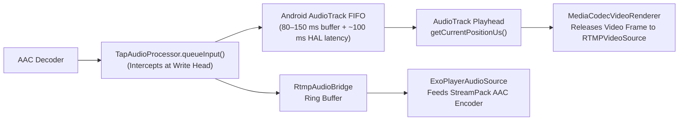

### How ExoPlayer Plays & Syncs RTMP Audio and Video

Inside ExoPlayer, `TapAudioProcessor` is placed **upstream of `AudioTrack`**, while **video rendering (`RTMPVideoSource`) is paced downstream of `AudioTrack`**:

Here is what happens to a single moment of RTMP audio + video (say, **PTS = 1.000s**):

1. **Audio is intercepted early (at the *back* of `AudioTrack`):**
   - As soon as `MediaCodecAudioRenderer` decodes audio for `PTS = 1.000s`, `DefaultAudioSink` runs [`TapAudioProcessor.queueInput()`](file:///Users/dmytroantonov/git/LifeStreamerV2/app/src/main/java/com/dimadesu/lifestreamer/rtmp/audio/RtmpAudioBridge.kt#L502-L508) **immediately**, right as it writes those samples into the *back* of Android's `AudioTrack` buffer.
2. **Video is held back until that audio reaches the *front* of `AudioTrack`:**
   - ExoPlayer's `MediaCodecVideoRenderer` does **not** render the matching video frame (`PTS = 1.000s`) when it is decoded.
   - Instead, it waits until `DefaultAudioSink.getCurrentPositionUs()` reaches `1.000s`.
   - `getCurrentPositionUs()` queries `AudioTrack`'s playhead **minus** the hardware `AudioTrack` buffer (`80–150 ms`, or `AudioTrack.getMinBufferSize * 2`) **minus** Android's audio HAL output latency (`AudioTrack.getLatency()`, typically another `80–150 ms`).
   - So ExoPlayer delays rendering the video frame to [`RTMPVideoSource`](file:///Users/dmytroantonov/git/LifeStreamerV2/app/src/main/java/com/dimadesu/lifestreamer/rtmp/video/RTMPVideoSource.kt#L465) by **~150–250 ms** so it would match a physical speaker!

---

### Why Our Previous Change Made Desync Happen Immediately at Start

Look at what happens at startup in [RtmpSourceSwitchHelper.kt](file:///Users/dmytroantonov/git/LifeStreamerV2/app/src/main/java/com/dimadesu/lifestreamer/ui/main/RtmpSourceSwitchHelper.kt#L246-L295) and [ExoPlayerAudioSource.kt](file:///Users/dmytroantonov/git/LifeStreamerV2/app/src/main/java/com/dimadesu/lifestreamer/rtmp/audio/ExoPlayerAudioSource.kt#L94-L98):

1. When `exoPlayerInstance.prepare()` reaches `STATE_READY` in `awaitReady()`, `DefaultAudioSink` immediately pre-fills `AudioTrack` with the first **~150 ms of audio (`PTS = 0..150 ms`)**.
   - As it pre-fills `AudioTrack`, `TapAudioProcessor` also writes `PTS = 0..150 ms` into `RtmpAudioBridge`.
2. Next, we attach `RTMPVideoSource` and `ExoPlayerAudioSource`, and call **`RtmpAudioBridge.flushRingBuffer()`** ([RtmpSourceSwitchHelper.kt#L290](file:///Users/dmytroantonov/git/LifeStreamerV2/app/src/main/java/com/dimadesu/lifestreamer/ui/main/RtmpSourceSwitchHelper.kt#L290) and [ExoPlayerAudioSource.kt#L96](file:///Users/dmytroantonov/git/LifeStreamerV2/app/src/main/java/com/dimadesu/lifestreamer/rtmp/audio/ExoPlayerAudioSource.kt#L96)).
   - **What `flushRingBuffer()` just did:** It deleted `PTS = 0..150 ms` from `RtmpAudioBridge`—**even though `PTS = 0..150 ms` is still sitting inside `AudioTrack` waiting to play!**
3. Now playback starts:
   - ExoPlayer renders **Video `PTS = 0 ms`** (synced to the *front* of `AudioTrack`).
   - At that exact same millisecond, `DefaultAudioSink` writes the *next* chunk (**Audio `PTS = 150..170 ms`**) into the *back* of `AudioTrack` and into the freshly-emptied `RtmpAudioBridge`.
   - `ExoPlayerAudioSource` immediately pulls **Audio `PTS = 150..170 ms`** and sends it to the AAC encoder while the video encoder is encoding **Video `PTS = 0 ms`**!
4. And even if `RtmpAudioBridge` had ~150 ms buffered to match `AudioTrack`, the `> 100 ms` 5% catch-up in [ExoPlayerAudioSource.kt](file:///Users/dmytroantonov/git/LifeStreamerV2/app/src/main/java/com/dimadesu/lifestreamer/rtmp/audio/ExoPlayerAudioSource.kt#L134-L139) actively drains `RtmpAudioBridge` below 100 ms, pulling audio **ahead** of `AudioTrack`'s playhead (and feeding 5% extra samples into the AAC encoder).

---

### Why `MediaProjection` Didn't Have This Offset
With `MediaProjection`, Android captured audio **after** `AudioTrack` played it out at the playhead—so audio went through the exact same `AudioTrack` FIFO delay that ExoPlayer used to delay video.
With `TapAudioProcessor`, we intercept audio **before** it enters `AudioTrack`'s FIFO.

---

### How to Make Audio & Video Sync From the Start
Because `TapAudioProcessor` splits audio right *before* `AudioTrack`, **`RtmpAudioBridge` is running in parallel with `AudioTrack`**:
1. **Don't wipe `RtmpAudioBridge` to 0 ms after `AudioTrack` has already pre-filled** (or instead of wiping to 0 ms, keep the ~150–200 ms of audio that is currently in-flight inside `AudioTrack`, or only cap excess above ~220 ms). That way, when `AudioTrack`'s playhead is at `PTS = 0 ms` (driving Video `PTS = 0 ms`), `RtmpAudioBridge`'s read pointer is also at `PTS = 0 ms`!
2. **Remove the 5% pull-rate speedup** in [ExoPlayerAudioSource.kt](file:///Users/dmytroantonov/git/LifeStreamerV2/app/src/main/java/com/dimadesu/lifestreamer/rtmp/audio/ExoPlayerAudioSource.kt#L134-L139) so `ExoPlayerAudioSource` always drains `RtmpAudioBridge` at the exact same `1.0x` rate that `AudioTrack` drains its buffer.
3. **Cap `RtmpAudioBridge` at ~250 ms (matching `AudioTrack` + HAL latency)** instead of 750 ms (which was too late when reconfiguring audio settings) or 0 ms flushed (which is too early). When reconfiguring audio settings (`applyAudioConfigSafely`), trim `RtmpAudioBridge` to ~150–180 ms (the `AudioTrack` depth) rather than 0 ms or 750 ms.
